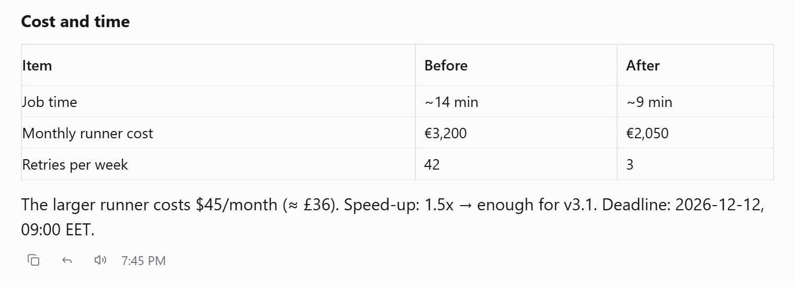
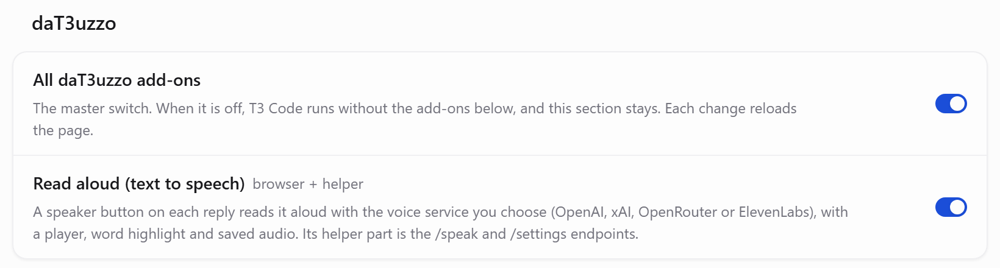

# daT3uzzo

daT3uzzo is daTuzzo's playground of add-ons for [T3 Code](https://github.com/pingdotgg/t3code). Each add-on is a feature that T3 Code does not have yet, or not in this form. Anyone may use them, change them or copy them (MIT). Some of them may go upstream as pull requests later.

Every add-on has its own switch in T3 Code under **Settings > General > daT3uzzo**, and one master switch turns them all off. T3 Code updates itself often, so the add-ons do not change T3 Code's code. A small helper on your PC adds one loader block to T3 Code's page, and adds it again after each update.





Both screenshots come from the stand-in test page in `eval/`, with made-up text.

## The add-ons

| Add-on | Kind | What it does |
|---|---|---|
| **Read aloud** (`t3-read-aloud`) | browser + helper | A speaker button on each finished reply. It reads the reply aloud, with a player (play, pause, seek, speed), word highlighting, follow-along scrolling and saved audio. |
| **Usage periods** (`usage-periods`) | client patch, optional | The Usage page with 180 days, 1 year and a custom range. Advanced: see [Client patches](#client-patches-advanced-optional). |

### Read aloud

- A speaker button sits next to Copy and Reply on each finished reply. A player strip opens at the top of the chat.
- **Exact** reading (the default) reads the reply word for word. **Adapt** cleans it up for listening. In both modes, code spells out numbers, dates, money, versions and IDs, and code blocks are skipped with their length said instead.
- **Word highlighting**: a soft pill moves behind the word being spoken. A second colour marks places where the speech differs from the text, for example a number read out in words.
- **Saved audio**: each spoken piece is kept on your PC. Playing a reply again costs nothing and needs no key.
- **Settings > Voice > Read aloud** holds the voice service, key, model, voice, mode, speed and saved-audio size.

Voice services:

| Service | Uses T3 Code's key | Reading modes | Word timing | Cost per audio minute |
|---|---|---|---|---|
| OpenAI Realtime (default) | yes | Exact, Adapt | OpenAI `whisper-1` | $0.089, measured ([docs/test-results.md](docs/test-results.md)) |
| xAI | yes | Exact | from xAI | about $0.015 (list price: $15 per 1M characters) |
| OpenRouter | yes | Exact | `whisper-1` when an OpenAI key exists, else estimated | depends on the model |
| ElevenLabs | no, a separate key | Exact | from ElevenLabs | list price: $0.04 to $0.08 per 1,000 characters |

Word highlighting with OpenAI or OpenRouter adds speech-to-text at about $0.006 per audio minute (OpenAI's list price for `whisper-1`). Turn highlighting off in Settings to skip it. A reply played again from saved audio costs $0.

The measured numbers for OpenAI Realtime with `gpt-realtime-2.1`: the first sound comes after about 1 to 2.6 seconds, and the helper makes about 3.8 seconds of audio per second, so you can seek ahead soon after the start. One hour of listening costs about $5.33.

## Install on Windows (2 minutes)

You need T3 Code (Stable or Nightly), [Python](https://www.python.org/downloads/) 3.11 or later, and [Git](https://git-scm.com/download/win).

```
git clone https://github.com/daTuzzo/daT3uzzo
cd daT3uzzo
py -m venv .venv
.venv\Scripts\python -m pip install -r requirements.txt
.venv\Scripts\python -m dat3uzzo install
```

Then press **Ctrl+R** in T3 Code once.

`install` does 4 things:
1. It adds the loader block to T3 Code's page: in the desktop app's `server.asar`, and in each server version under `~/.t3/runtime/versions/`.
2. It adds `daT3uzzo.lnk` to your Startup folder, so the helper starts when you log in.
3. It adds two desktop shortcuts, "daT3uzzo off" and "daT3uzzo on" (see [the off switch](#turn-add-ons-on-and-off)).
4. It starts the helper.

Check it with `.venv\Scripts\python -m dat3uzzo status`.

### The key for read-aloud

Read-aloud uses the OpenAI key that you save in T3 Code for dictation. In T3 Code, open **Settings > Voice**, choose OpenAI and save your key. T3 Code keeps it in `~/.t3/userdata/secrets/`, and the helper reads it from there for each request. A key saved as a 1Password reference also works when the 1Password CLI (`op`) is installed.

To use another service, or a key only for read-aloud, open **Settings > Voice > Read aloud** and save a separate key there. The helper keeps it in Windows Credential Manager. The page never shows a saved key again.

### Let an agent install it

[docs/INSTALL-FOR-AGENTS.md](docs/INSTALL-FOR-AGENTS.md) is a step-by-step procedure for a coding agent. Paste this line into your agent:

```
Install daT3uzzo for T3 Code on this computer: follow https://github.com/daTuzzo/daT3uzzo/blob/main/docs/INSTALL-FOR-AGENTS.md step by step, and never read or print my API keys or the daT3uzzo token.
```

## Where it works

T3 Code has two copies of its page. The desktop app serves one from inside its `server.asar`. The T3 server serves the other to browsers, from `~/.t3/runtime/versions/<version>/client/index.html` (or `$T3CODE_HOME` instead of `~/.t3`). The helper patches both.

| Place | Works | How it was tested |
|---|---|---|
| Desktop app, Windows, Nightly | Yes | On the author's PC: `status` shows the desktop app as patched, and read-aloud runs in it. |
| Desktop app, Windows, Stable | Yes, not run | T3 Code's packaging config and a unit test for the Stable file names. Stable is `T3 Code (Beta).exe` and Nightly is `T3 Code (Nightly).exe`. Both have the same app id, so both install to `%LOCALAPPDATA%\Programs\t3code`, and installing one replaces the other. |
| Browser, T3 server on the same PC | Yes | Headless Chrome on `http://127.0.0.1:3773`: the page came with the loader block, the add-ons loaded, and `/settings` answered. |
| Browser, T3 server on another machine | Yes, with setup | Stand-in pages and headless Chrome: an allowed origin loads the add-ons, a refused origin gets nothing. Needs `allow-origin` and the userscript or the browser extension, see [docs/HOW-IT-WORKS.md](docs/HOW-IT-WORKS.md#t3-code-on-another-machine). |
| Hosted app `https://app.t3.codes` | Should work, not tested | It sends no Content-Security-Policy, so the userscript can run there. Same setup as another machine. |
| Desktop app, macOS | No | macOS seals the app's files with its code signature. Use a browser with the userscript. |
| Desktop app, Linux | No | The AppImage is read-only, and the deb installs as root. Use the browser. |
| Browser, T3 server on Linux or macOS | Should work, not tested | The page patch and the helper are plain Python, and the unit tests run on Linux in CI. Nobody has run the helper with a real T3 Code on Linux or macOS yet. There is no autostart: start it at login with `python -m dat3uzzo serve`. |
| T3 Code mobile app, a phone's browser | No | The mobile app has no web page, and a phone's `127.0.0.1` is the phone. |

## Turn add-ons on and off

- **In T3 Code**: Settings > General > daT3uzzo. Each switch reloads the page.
- **From a terminal**, in the daT3uzzo folder:
  ```
  .venv\Scripts\python -m dat3uzzo ui status
  .venv\Scripts\python -m dat3uzzo ui off
  .venv\Scripts\python -m dat3uzzo ui on
  .venv\Scripts\python -m dat3uzzo ui mod t3-read-aloud off
  ```
- **When T3 Code's page is broken**: double-click the **daT3uzzo off** shortcut on the desktop, then press Ctrl+R in T3 Code. Without the shortcut, edit `%LOCALAPPDATA%\dat3uzzo\ui.json` and set `"enabled": false`.

When the master switch is off, the helper still sends the switches page but no add-on. A client patch goes back to T3 Code's original files at the next T3 Code restart.

## Write a new add-on

### A browser add-on

Add one file to `web/`. Its name is its id. Two header lines give its label and description in Settings:

```js
// @mod-label Copy as plain text
// @mod-desc  Adds a button that copies a reply without markdown.
(() => {
  "use strict";
  // Your code runs in T3 Code's page. window.__DAT3UZZO__ holds the helper's port and token.
  console.log("hello from my add-on");
})();
```

Press Ctrl+R in T3 Code. The add-on shows up in Settings with its own switch, with no change to the helper. Each add-on runs in its own error guard, so a broken add-on stops only itself. Use T3 Code's own markup and class names, and let every hook fail quietly when T3 Code changes.

### A helper add-on

A helper add-on is a feature of the Python helper: an endpoint, or a background job. Declare it once in `HELPER_MODS` in `dat3uzzo/ui.py`, then check its switch before it acts:

```python
# dat3uzzo/ui.py
HELPER_MODS = {
    "t3-read-aloud": ("Read aloud (text to speech)", "The /speak endpoint ..."),
    "word-count": ("Word count", "GET /word-count returns the number of words in a text."),
}

# dat3uzzo/server.py, in _route()
if url.path == "/word-count":
    if not _token_ok(url.query):
        return _response(HTTPStatus.FORBIDDEN, b"forbidden\n", "text/plain")
    off = _switched_off("word-count")  # 503 while its switch or the master switch is off
    if off:
        return off
    text = (parse_qs(url.query).get("text") or [""])[0]
    return _response(HTTPStatus.OK, str(len(text.split())).encode(), "text/plain")
```

An id that is both a `web/<id>.js` file and a `HELPER_MODS` entry is one add-on with one switch. Restart the helper after a Python change: `.venv\Scripts\python -m dat3uzzo restart`. It does not touch T3 Code.

## Client patches (advanced, optional)

A client patch is a T3 Code commit that changes T3 Code's own page files, for example the Usage page. The helper builds T3 Code's web client with the commit for your installed version, then swaps the rebuilt `server.asar` in while T3 Code is closed. It does this again by itself for each new T3 Code version. Windows desktop app only.

You need Git, Node.js and a clone of T3 Code's repo. A new install has no client patches. To add the Usage periods patch:

```
git clone https://github.com/pingdotgg/t3code C:\src\t3code
git -C C:\src\t3code remote add fork https://github.com/daTuzzo/t3code
```

Then put this in `%LOCALAPPDATA%\dat3uzzo\client-patches.json`:

```json
{
  "repo": "C:\\src\\t3code",
  "patches": [
    {
      "id": "usage-periods",
      "label": "Usage: 180 days, 1 year and a custom range",
      "commits": ["b3b98439c0be67a0a10569caa3f2bf27176b5254"],
      "remote": "fork"
    }
  ]
}
```

The patch gets a row in Settings > General > daT3uzzo with its status. A build takes about 5 minutes, at idle priority. The swap waits until T3 Code is closed, or the row's **Restart T3 now** button closes T3 Code gracefully and opens it again. The helper backs up the original `server.asar` first and never overwrites a backup. [docs/HOW-IT-WORKS.md](docs/HOW-IT-WORKS.md#client-patches) has the details.

## Uninstall

```
.venv\Scripts\python -m dat3uzzo uninstall
```

It stops the helper, puts back T3 Code's original files, removes the Startup and desktop shortcuts, and asks before it deletes the saved audio (`--keep-cache` keeps it). When a client patch is swapped in, close T3 Code first. Then press Ctrl+R in T3 Code and delete the folder.

## Privacy and safety

- The helper listens on `127.0.0.1` only. Nothing on your network can reach it.
- Each speech, settings or switch request needs a random token. `install` writes the token into T3 Code's page, so other local web pages cannot use your keys or change a setting.
- Every request, WebSockets included, first passes an `Origin` check. Pages from other origins get a 403 unless you allow them with `allow-origin`.
- The helper reads a key only for the request that needs it. It never logs a key and never sends one to the page. A separate key lives in Windows Credential Manager (macOS Keychain, Secret Service on Linux), never in a plain file.
- The reply text goes only to the voice service you chose. The log records sizes, timings and the service name, not reply text.
- Saved audio holds your spoken replies on your PC in `%LOCALAPPDATA%\dat3uzzo\cache`, readable by your Windows account. Settings sets its size or clears it.
- The desktop patch edits one file inside `server.asar` at its exact byte size, after a backup. It refuses to patch when the app enforces archive integrity, or when the page is not the one the archive records.

## Contributing

Issues and pull requests are welcome. Before a pull request:

```
.venv\Scripts\python -m unittest discover -s tests
```

The tests use local fakes for every voice service, key and T3 Code install, so they cost nothing. Keep one add-on per file, with no build step. Never commit a key, a token or text from a real chat: `eval/samples/` holds made-up replies for testing.

## Upstream

T3 Code is made by [pingdotgg](https://github.com/pingdotgg/t3code). daT3uzzo is not part of it. When an add-on is good enough, the plan is to offer it upstream. The first merged change from this work: [pull request #41730](https://github.com/pingdotgg/t3code/pull/41730), "automatic port selection checks the address the server binds", which fixes [issue #41729](https://github.com/pingdotgg/t3code/issues/41729).

## Licence

[MIT](LICENSE), copyright 2026 daTuzzo. The Python libraries are used unmodified: `websockets` (BSD-3-Clause), `num2words` (LGPL-2.1), `lameenc` (LGPL-3.0-or-later), `keyring` (MIT) and `miniaudio` (MIT). Icons: Lucide (ISC).
